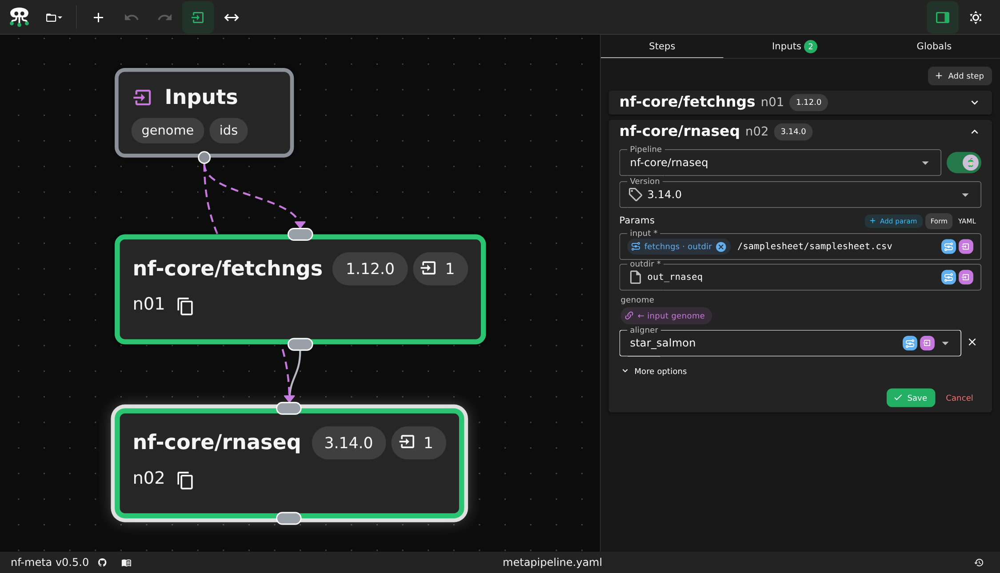

# nf-meta: metapipeline representation, editor, and runner

A reproducible representation for Nextflow metapipelines — chains of nf-core/Nextflow pipeline
and module runs — with an interactive browser-based editor and a CLI validator/runner.

**This is a beta version: things can be unstable and change.**

📖 **[Documentation](https://bmds-tue.github.io/nf-meta/)** — installation, quickstart, the
full config reference, and the API reference.

Find a growing collection of examples in the dedicated
[showcase repository](https://github.com/bmds-tue/nf-meta-showcases/tree/main).



Start the editor with `nf-meta editor [metapipeline.yaml]`. Configs on a cluster? Run it there and
use it from your own browser through an SSH tunnel:
[Running the editor on a remote machine](https://bmds-tue.github.io/nf-meta/latest/editor/#running-the-editor-on-a-remote-machine).

## Representation

A metapipeline is a `.yaml` file. The most important keys are:

* `config_version` — allows the representation to change over time without breaking
* `steps` — the nextflow / nf-core pipeline and module _runs_. The flow from step to step is
  described by each step's own `from:` key
* `globals` — settings that apply to all steps

```yaml
config_version: 0.5.0
globals:
  nextflow_version: "25.10"
steps:
  n01:
    name: nf-core/fetchngs
    version: 1.12.0
    params:
      input: fetchngs-ids.csv
      outdir: out_fetchngs
      nf_core_pipeline: rnaseq
      nf_core_rnaseq_strandedness: auto
  n02:
    from: n01
    name: nf-core/rnaseq
    version: 3.14.0
    params:
      input: ${n01:params:outdir}/samplesheet/samplesheet.csv
      genome: GRCh38
      outdir: out_rnaseq
```

Fields can reference another workflow's own params, so you write
`input: ${n01:params:outdir}/samplesheet/samplesheet.csv` instead of hardcoding
`input: fetchngs_out/samplesheet/samplesheet.csv`.

See the [config reference](https://bmds-tue.github.io/nf-meta/latest/representation/reference/)
for every key, and [cross-workflow references](https://bmds-tue.github.io/nf-meta/latest/representation/interpolation/)
for the full `${...}` syntax.

## Runners

Currently:
* **Python runner** — wraps `nextflow` commands, executes in DAG order.

Planned:
1. [nf-cascade](https://github.com/mahesh-panchal/nf-cascade/) runner — convert the config into
   one daisy-chained Nextflow script.
2. Seqera Platform runner — start and monitor locally, calling a Platform instance's API with
   run parameters to handle running Nextflow.
3. Meta-pipeline runner — compile the config into a new monolithic Nextflow project that
   imports the required workflows, for the most efficient orchestration and graceful error
   handling.

Runners are pluggable — see the [runner docs](https://bmds-tue.github.io/nf-meta/latest/runners/)
to write your own.

## Install from PyPI

```bash
# with pip
pip install nf-meta

# with uv
uv add nf-meta
```

## Development setup

```bash
git clone https://github.com/bmds-tue/nf-meta
cd nf-meta
uv sync --group dev
uv run pytest
```

To work on the editor, run the frontend dev server and start the editor in dev mode
(`NF_META_DEVMODE=1`), then open the link it prints (`http://127.0.0.1:5180/?token=…`):

```bash
# terminal 1
cd src/nf_meta/editor/frontend && npm install && npm run dev
# terminal 2
NF_META_DEVMODE=1 uv run nf-meta editor [path/to/metapipeline.yaml]
```

See [Contributing](https://bmds-tue.github.io/nf-meta/latest/contributing/) for details, and the
[docs](https://bmds-tue.github.io/nf-meta/) for the editor and the full API reference.
