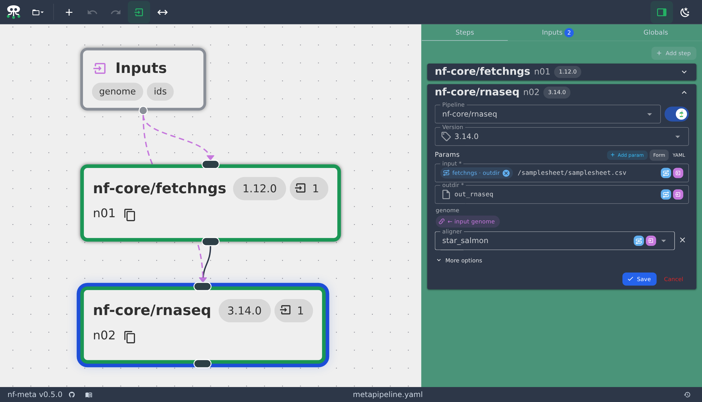

# nf-meta: metapipeline representation, editor, and runner

A metapipeline is a directed acyclic graph of Nextflow
pipeline or module steps, where later steps can read their inputs
from the results of earlier ones.
`nf-meta` describes a whole metapipeline in a single YAML file, that restores the
reproducibility of multi-step analyses and ships with an
interactive browser-based editor for these files as well as a CLI validator/runner.

**This is a beta version: things can be unstable and change.**

📖 **[Documentation](https://bmds-tue.github.io/nf-meta/latest)** — installation, quickstart, the
full config reference, and the API reference.

Find a growing collection of examples in the dedicated
[showcase repository](https://github.com/bmds-tue/nf-meta-showcases/tree/main).

<picture>
  <source media="(prefers-color-scheme: dark)" srcset="assets/nf-meta-screenshot.png">
  
</picture>

* **One file for the whole chain:** steps, the flow between them, shared settings, and the
  values supplied at run time (inputs), validated against each pipeline's own schema.
* **Run it:** `nf-meta run` runs the steps in directed order from one output folder, 
  skips already succeeded and resumes Nextflow's tasks for the rest.
* **Edit it visually:** a browser-based editor with schema-based forms, references and inputs
  picked from menus, and undo/redo. It also runs on a cluster, used through an SSH tunnel.
* **Share it:** run or open a published config straight from its URL.

Start the editor with `nf-meta editor [metapipeline.yaml]`. Configs on a cluster? Run it there and
use it from your own browser through an SSH tunnel:
[Running the editor on a remote machine](https://bmds-tue.github.io/nf-meta/latest/editor/#running-the-editor-on-a-remote-machine).

## Representation

A metapipeline is a `.yaml` file. The most important keys are:

* `config_version` — allows the representation to change over time without breaking
* `steps` — the nextflow / nf-core pipeline and module _runs_. The flow from step to step is
  described by each step's own `from:` key
* `globals` — settings that apply to all steps
* `inputs` — values supplied when the metapipeline runs (optional)

```yaml
config_version: 0.5.0
globals:
  nextflow_version: "25.10"
steps:
  n01:
    name: nf-core/fetchngs
    version: 1.12.0
    params:
      input: ${inputs:ids}
      outdir: out_fetchngs
      nf_core_pipeline: rnaseq
      nf_core_rnaseq_strandedness: auto
  n02:
    from: n01
    name: nf-core/rnaseq
    version: 3.14.0
    params:
      input: ${n01:params:outdir}/samplesheet/samplesheet.csv
      genome: GRCh38
      outdir: out_rnaseq
```

Params can reference another step's params, so you write
`input: ${n01:params:outdir}/samplesheet/samplesheet.csv` instead of hardcoding
`input: out_fetchngs/samplesheet/samplesheet.csv`. `${inputs:ids}` leaves the value to the person
running it: `nf-meta run metapipeline.yaml --input ids=fetchngs-ids.csv`, or a prompt.

See the [config reference](https://bmds-tue.github.io/nf-meta/latest/representation/reference/) for every key,
[cross-step references](https://bmds-tue.github.io/nf-meta/latest/representation/interpolation/) for the `${...}` syntax,
[inputs](https://bmds-tue.github.io/nf-meta/latest/representation/inputs/), and [running a metapipeline](https://bmds-tue.github.io/nf-meta/latest/runners/#python-runner)
for output folders and `--resume`.

## Runners

Currently:
* **Python runner**: Wraps `nextflow` commands, runs the steps in DAG order.

Planned:
1. [nf-cascade](https://github.com/mahesh-panchal/nf-cascade/) runner: convert the config into
   one daisy-chained Nextflow script.
2. Seqera Platform runner: start and monitor locally, calling a Platform instance's API with
   run parameters to handle running Nextflow.
3. All-in-nextflow meta-pipeline runner: compile the config into a new Nextflow project that
   imports the required workflows, for the most efficient orchestration and graceful error
   handling.

More runners can be added via third-party plugins. (see the [runner docs](https://bmds-tue.github.io/nf-meta/latest/runners/))

## Install from PyPI

```bash
# with pip
pip install nf-meta

# as a command-line tool with uv
uv tool install nf-meta
```

Running needs [Nextflow](https://nextflow.io) on `PATH`.

## Development setup

```bash
git clone https://github.com/bmds-tue/nf-meta
cd nf-meta
uv sync --group dev
uv run pytest
```

To work on the editor frontend and get live-builds, run the frontend dev server manually
and start the editor in dev mode. (via the `NF_META_DEVMODE=1` env variable)
Then open the link it prints (`http://127.0.0.1:5180/?token=…`):

```bash
# terminal 1, run this first
cd src/nf_meta/editor/frontend && npm install && npm run dev
# terminal 2
NF_META_DEVMODE=1 uv run nf-meta editor [path/to/metapipeline.yaml]
```

See [Contributing](https://bmds-tue.github.io/nf-meta/latest/contributing/) for details, and the
[docs](https://bmds-tue.github.io/nf-meta/latest) for the editor and the full API reference.
