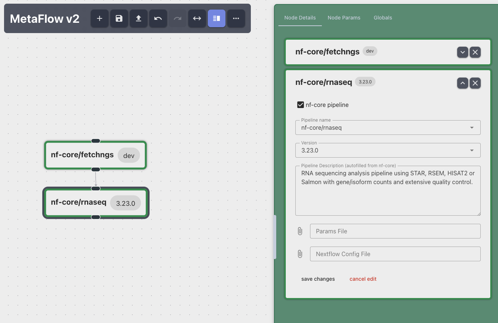

# Editor

The `nf-meta` package ships a browser-based editor for interactively visualizing and editing metapipeline configs.
Autocompleted and validated forms for updating workflow attributes can make creating or extending workflow chains easier, if you are not used to hand-writing YAML directly.
Because mistakes can happen, the edit history allows going back to a previous state or reapplying a change you made.



## Usage

```bash
# start fresh
nf-meta editor 

# or open some existing work
nf-meta editor [path/to/metapipeline.yaml]
```

!!! note
    The `editor` starts and continues to run a session which essential for the browser page to work.
    It will not terminate and block the current prompt until you do so manually. (`Ctrl` + `C` or `Cmd` + `C`)


This serves the editor's frontend and automaatically opens it in a browser tab, backed by a local session and state.
(`nf_meta.core.session`)
The session tracks graph mutations by updating the internal history, fetches data while keeping a local cache, and responds to validation requests.
Passing no path starts a new, empty metapipeline.

## Editor backends

The editor is extensible via plugins in the same way runners are: `--editor <name>` selects a registered
`BaseEditor` subclass.
The one described above is the only one shipped with nf-meta right now and opens by default.
See [Writing an editor plugin](../guides/writing-an-editor-plugin.md)
to add another.
