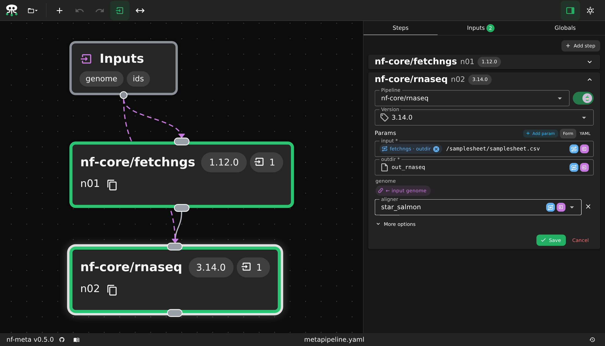
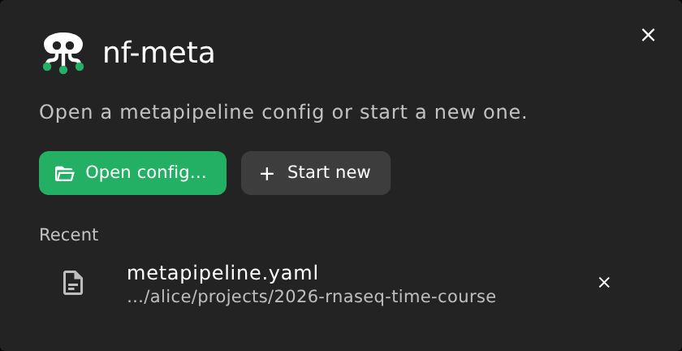
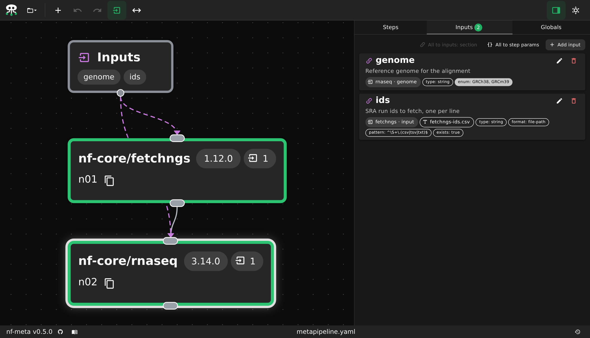
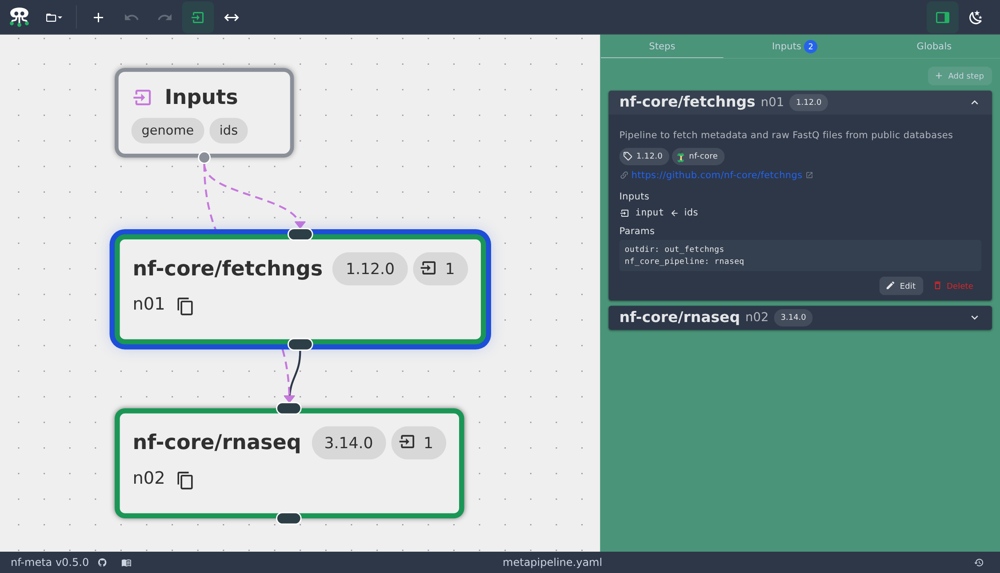

# Editor

The `nf-meta` package ships a browser-based editor for building and changing metapipeline
configs visually: steps as a graph, schema-based forms for their params, references and inputs
picked from menus, and validation as you edit. Every change is saved to the config file right
away, and the history (undo, redo) takes you back to any earlier state.



## Usage

```bash
# start fresh
nf-meta editor

# or open some existing work
nf-meta editor path/to/metapipeline.yaml
```

!!! note
    `nf-meta editor` runs the editor's backend, which the browser page needs. It keeps the
    terminal busy until you stop it: **Quit editor** in the page's file menu, or `Ctrl` + `C` in
    the terminal. Every change is already saved, so nothing is lost either way. **Quit editor**
    also closes the tab if the browser lets it; most only let a page close tabs it opened itself,
    so the tab usually stays open and says you can close it. A page whose editor has stopped says
    so; run `nf-meta editor` again and open the new link.

Started without a config, the editor shows a start screen: open a config (browsing the folders of
the machine running the editor), pick one of the configs you recently opened or saved there, or
start a new, empty metapipeline. Closing the start screen starts a new one too. It is shown once
per run of `nf-meta editor`, not again when you reload the page. The list of recent configs is
kept per user on that machine (`~/.local/state/nf-meta/recent-configs.json`).

{ width="420" }

A new config, or one opened from a URL (`nf-meta editor https://…`), asks where to save it before
your first change; for a URL, that is your local copy, and the published file stays as it is.
Cancelling leaves the change unsaved and your form open.

## Working with the editor

The graph shows the steps and the flow between them; the sidebar on the right has three tabs.
Drag its edge to make it wider.

**Steps.** One card per step; click a node or a card to open it. A step's form has the pipeline
or module (nf-core names and versions are completed from the nf-core catalog), and its params:

- **The params form** is built from the pipeline's `nextflow_schema.json` (or the module's
  `meta.yml`): a field per param, with its type, description and allowed values. "Add param"
  lists the params not set yet, required ones first. **Form/YAML** switches to editing the
  params as YAML, with completion and checks for references and inputs.
- **A reference** (the blue button next to a param) fills the param from another step's param:
  pick the step, then the param. The editor adds the edge between the steps when you save. A
  reference can have text after it, e.g. `/samplesheet/samplesheet.csv`.
- **An input** (the purple button) makes the param a value supplied at run time; see
  [Inputs](../representation/inputs.md).
- **More options** holds the params file, Nextflow config and profile, the main script and, for
  pipelines you develop yourself, a **local folder** instead of the repository (marked "local";
  see [Developing a pipeline locally](../representation/overview.md#developing-a-pipeline-locally)).

Problems show at the field they belong to; a change the checks refuse is not saved.

**Inputs.** All inputs of the metapipeline, with the params they fill. Hovering an input
highlights its steps on the graph. An input's form sets its description, default and rules
(type, format, allowed values, …), and the step params it fills: "Add step param" picks the step,
then the param, with each param's description, type and default. A choice at the top writes all
inputs in the steps' params or all in the `inputs:` section.



**Globals.** Settings for every step: Nextflow version, profile and config, and shared params.

The button at the top right switches between the dark and the light theme.



Fields that take a path (a step's params file and Nextflow config, the global Nextflow config,
params and input defaults with a path format) have a folder button that browses the machine
running the editor and fills in the absolute path of the file or folder you pick. You can also
type the path, relative to the config's folder, or a URL for params and input defaults. Whatever
is in the field is saved as it is. `outdir` has no button: a relative `outdir` is placed in the
run's output folder.

!!! tip "Configs on a cluster?"
    Run the editor on the cluster and use it in your own browser through an SSH tunnel:
    see [Running the editor on a remote machine](#running-the-editor-on-a-remote-machine).

### The editor link

On start, the editor prints its address with an access token, for example
`Editor running at: http://127.0.0.1:8080/?token=…`, and opens that link in your browser. The page
keeps the token for the tab and sends it with every request; without it, the editor refuses to
read or write anything. This keeps other users of a shared machine (and websites open in your
browser) out of your configs. If a tab shows "Cannot reach the editor backend", open the printed
link again; each start of `nf-meta editor` makes a new token.

The browser gets the link through a small file only you can read (in `$XDG_RUNTIME_DIR` or
`~/.cache/nf-meta/editor`, removed when the editor stops), so the token doesn't show up in the process list
of a shared machine. When the browser runs on another machine (VS Code Remote-SSH, dev containers,
Codespaces), that file doesn't exist there: start with `--no-redirect-file` to open the link
directly, or open the printed link yourself.

The editor also only answers requests addressed to `localhost` or `127.0.0.1` (or the name given
with `--host`).

## Editor backends

The editor is extensible via plugins in the same way runners are: `--editor <name>` selects a registered
`BaseEditor` subclass.
The one described above is the only one shipped with nf-meta right now and opens by default.
See [Writing an editor plugin](../guides/writing-an-editor-plugin.md)
to add another.

## Running the editor on a remote machine

Data and pipelines usually live on a cluster with no access to a display server or a browser.
To use the editor there anyway, run its backend on the cluster and connect to it through an **SSH tunnel**.

On the cluster start the editor backend:

```bash
$ nf-meta editor --port 8080
Editor running at: http://127.0.0.1:8080/?token=Xq3…
Started over SSH: to use the editor from your own computer, forward its port there
    ssh -N -L 8080:localhost:8080 alice@login01
(with the host name you log in with), then open the link above in your browser.
```

On the computer with a browser, run the following command with the host name of your remote machine to start the tunnel:

```bash
$ ssh -N -L 8080:localhost:8080 alice@hpc.example.org
```

You will now be able to visit the printed link in your local browser.

### VS Code Remote-SSH

In the terminal of a VS Code Remote-SSH window, the port is forwarded automatically.
Start the editor with `--no-redirect-file`, so the link can be opened on your computer's browser:

```bash
nf-meta editor --port 8080 --no-redirect-file
```
